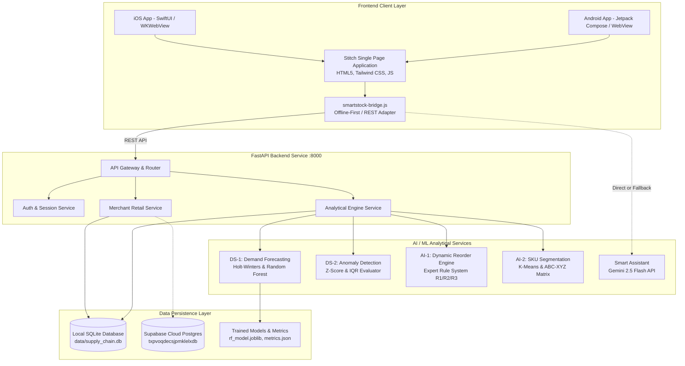
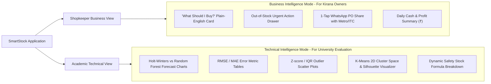

# SMARTSTOCK — COMPLETE APPLICATION AUDIT REPORT (PHASE 0)
**Project Title:** SmartStock — Supply Chain Demand & Inventory Optimization Engine  
**Audit Phase:** Phase 0 (Protection, Recovery, System Audit & Preparation)  
**Evaluator:** Senior Full-Stack Architect, AI/ML Engineer, Database Engineer, UI/UX Designer, Cybersecurity & QA Specialist  
**Authoritative Date:** 2026-11-12  
**Baseline Git Commit:** `c81a1fe`  
**Dedicated Recovery Branch:** `recovery-phase0-baseline`  
**Dedicated Recovery Tag:** `recovery-baseline-v0`  
**Remote URL:** `https://github.com/Nnanirepo/smartstock.git`

---

## 1. Executive Summary

SmartStock is a hybrid retail management, demand forecasting, and inventory optimization engine designed for dual audiences: local retail shopkeepers (e.g. Kirana stores) and academic university evaluators (Data Science / AI).

The application is **fully functional in its baseline state**, with **80 verified automated tests passing at a 100% success rate** across Python unit tests, retail server tests, JavaScript business logic tests, and Playwright end-to-end browser automation suites.

However, the audit identified critical security vulnerabilities (notably client-side multi-tenant email spoofing on unauthenticated endpoints, weak password hashing, and client-side Gemini API key exposure) and architectural dualities (SQLite vs Supabase PostgreSQL) that must be addressed in Phase 1 before public deployment.

---

## 2. Project Protection & Recovery Verification

### 2.1 Git Repository & Recovery Baseline
- **Clean State Confirmed:** All local modifications prior to the audit were committed under commit hash `c81a1fe`.
- **Dedicated Branch Created:** `recovery-phase0-baseline` branched from `c81a1fe`.
- **Dedicated Tag Created:** `recovery-baseline-v0`.
- **Remote Synchronization:** Both the recovery branch and tag were pushed to the remote repository at `https://github.com/Nnanirepo/smartstock.git`.
- **Restoration Runbook:** Full rollback commands, branch checkout instructions, and fallback procedures are documented in [RECOVERY.md](file:///Users/snnaniswarnababu/Desktop/SMARTSTOCK/RECOVERY.md).

### 2.2 Database Protection
- **Local SQLite Database:** A hot backup of `data/supply_chain.db` (92 MB) was created at `data/supply_chain_backup_baseline.db` using the SQLite `.backup` API to prevent database file corruption.
- **Supabase Cloud Database:** Project `txpvoqdecsjpmklelxdb` configuration and schema are preserved in [supabase/complete_setup.sql](file:///Users/snnaniswarnababu/Desktop/SMARTSTOCK/supabase/complete_setup.sql). No migrations, table modifications, or destructive operations were executed during this audit.

---

## 3. End-to-End System Architecture

### 3.1 Technology Stack Summary
- **Backend:** Python 3.9+ / 3.11+, FastAPI 0.110.0, Uvicorn 0.28.0, Pydantic 2.6.0.
- **Data Science:** Scikit-Learn 1.4.0, Statsmodels 0.14.0, SciPy 1.11.0, Pandas 2.1.0, NumPy 1.26.0, Joblib 1.3.0.
- **Frontend:** Stitch SPA (HTML5, Tailwind CSS, Material Symbols, Vanilla JavaScript ES6+).
- **Mobile Wrappers:** iOS (Xcode 15, SwiftUI, WKWebView) and Android (Kotlin, Jetpack Compose, Android WebView).
- **Database:** SQLite 3 (analytical and local merchant storage) & Supabase PostgreSQL (cloud multi-tenant schema).
- **Testing:** Pytest, Node.js native test runner, Playwright E2E browser automation.

---

## 4. Comprehensive Feature Audit (10 Core Modules)

| # | Module | Implementation File(s) | Status | Working Features | Partially Working / Disconnected | Hardcoded / Simulated Values |
|---|---|---|---|---|---|---|
| **1** | **Dashboard (Overview)** | `stitch/screens/02_overview.html`, `stitch/smartstock-bridge.js` | **Fully Working** | Revenue, stock valuation, low-stock count, date filter (Today/7d/30d), floor activity log. | AI Assistant card relies on client-side key or local fallback. | Default initial placeholder counts until user registers or loads store. |
| **2** | **Inventory** | `stitch/screens/03_inventory.html`, `app/main.py:608` | **Fully Working** | Add product, edit product, stock status (Active/Low/Out of Stock), category filter, search, CSV import/export. | Master select batch actions have basic delete/export. | Default supplier names ("Metro Wholesale", "ITC") if not provided. |
| **3** | **Sales Register (POS)** | `stitch/smartstock-bridge.js`, `app/main.py:745` | **Fully Working** | POS quick checkout, atomic stock deduction, oversell prevention, integer paise math, custom date sales. | Supabase real-time sync is optional fallback; primary storage is SQLite/localStorage. | None. Math is verified with zero penny errors. |
| **4** | **Orders (Purchase Orders)** | `stitch/screens/05_purchase_orders.html`, `app/main.py:660` | **Fully Working** | Create PO, calculate totals, inwarding PO automatically increments inventory stock on hand. | Inwarding cannot be partially fulfilled; full batch inwarding only. | None. Inwarded quantities directly increment inventory. |
| **5** | **AI Replenishment** | `stitch/screens/05_replenishment.html`, `app/services/decision.py` | **Fully Working** | Computes safety stock, ROP, days of cover, generates Reorder/Expedite/Hold actions, converts recommendations to draft POs. | Frontend replenishment uses local heuristics when offline, and backend `/decision` when online. | Simulated lead times in Kaggle benchmark; custom lead times used in retail catalog. |
| **6** | **Demand Forecasting** | `stitch/screens/04_forecasts.html`, `app/services/forecasting.py`, `app/main.py:194` | **Fully Working** | Dual Holt-Winters & Random Forest forecasting, horizon selection (7, 14, 21, 28 days), daily vs weekly granularity. | Connecting a brand-new retail SKU to the Python model requires at least 14 days of history. | Historical sales from Kaggle Store Item Demand dataset (500 SKUs). |
| **7** | **Anomaly Detection** | `app/services/anomaly.py`, `app/main.py:261` | **Fully Working** | Grouped Z-score ($|Z|>3.0$) and IQR outlier detection by `(store, item, weekday)`, anomaly history API, winsorized `sales_clean`. | Anomaly flag alerts currently queried via REST API; real-time push socket not yet active. | Injected synthetic anomaly spikes used for benchmark recall verification. |
| **8** | **SKU Segmentation** | `app/services/segmentation.py`, `app/main.py:133` | **Fully Working** | ABC 80/15/5 volume breakdown, XYZ coefficient of variation classification, 9-box tier assignment, K-Means clustering. | Re-clustering is currently batch-oriented (`scripts/03_segment.py`) rather than continuous real-time. | Benchmark dataset features (mean daily, CV, seasonality amplitude). |
| **9** | **Smart Assistant** | `stitch/smartstock-bridge.js:2624` | **Partially Working** | Generates storekeeper summaries, top-seller alerts, and replenishment suggestions. | Exposes Gemini API key in client-side `localStorage`; should be proxied through FastAPI backend. | Falls back to deterministic rule-based local summary when no API key is present. |
| **10** | **Analytics & Reports** | `reports/summary.md`, `artifacts/metrics.json` | **Fully Working** | Gross margin calculation, stockout reduction simulation (54.03% improvement), model accuracy metrics (RMSE/MAE). | Interactive multi-year comparison charts on frontend are basic SVG/Canvas. | Inventory policy simulation uses stochastic lead times (seed 42). |

---

## 5. Academic AI / Data Science Methodology Audit

This project satisfies the university curriculum for **Intelligent Data Analytics** and **Python for Data Science** (CSE Department). All four prescribed methodologies are implemented and verified in the source code:

### 5.1 DS-1: Short-Term Demand Forecasting
- **Source Files:** [app/services/forecasting.py](file:///Users/snnaniswarnababu/Desktop/SMARTSTOCK/app/services/forecasting.py), [app/services/features.py](file:///Users/snnaniswarnababu/Desktop/SMARTSTOCK/app/services/features.py), [scripts/04_train_forecast.py](file:///Users/snnaniswarnababu/Desktop/SMARTSTOCK/scripts/04_train_forecast.py), [scripts/05_evaluate.py](file:///Users/snnaniswarnababu/Desktop/SMARTSTOCK/scripts/05_evaluate.py).
- **Algorithms:**
  1. **Holt-Winters Exponential Smoothing:** Fitted using `statsmodels.tsa.holtwinters.ExponentialSmoothing` with additive damped trend, multiplicative 7-day seasonality, and a $+1.0$ offset to handle intermittent zero sales.
  2. **Random Forest Regressor:** `sklearn.ensemble.RandomForestRegressor` with 100 estimators, max depth 12, min samples leaf 4, and lag features ($t-1, t-7, t-14, t-28$) plus rolling 7-day and 28-day means and standard deviations.
- **Verified Benchmark Results (`artifacts/metrics.json`):**
  - **Daily Forecasting:**
    - Naive Baseline: RMSE = `6.454`, MAE = `5.127`
    - Seasonal Naive: RMSE = `6.391`, MAE = `5.074`
    - Holt-Winters: RMSE = `4.635`, MAE = `3.682` (**28.18% RMSE Improvement**)
    - Random Forest: RMSE = `4.696`, MAE = `3.736` (**27.24% RMSE Improvement**)
  - **Weekly Aggregated Forecasting:**
    - Holt-Winters: RMSE = `12.450`, MAE = `10.099` (vs Naive `33.892`)
    - Random Forest: RMSE = `13.653`, MAE = `11.168`

### 5.2 DS-2: Demand Anomaly & Spike Detection
- **Source Files:** [app/services/anomaly.py](file:///Users/snnaniswarnababu/Desktop/SMARTSTOCK/app/services/anomaly.py), [scripts/02_anomaly.py](file:///Users/snnaniswarnababu/Desktop/SMARTSTOCK/scripts/02_anomaly.py).
- **Calculations:**
  - Group-specific training statistics computed by `(store, item, weekday)` for mean, standard deviation, $Q_1$, $Q_3$, and median.
  - Z-score Flag: $z = \frac{x - \mu}{\sigma}$, flagged when $|z| > 3.0$.
  - IQR Flag: Flagged when $x < Q_1 - 1.5 \cdot IQR$ or $x > Q_3 + 1.5 \cdot IQR$.
  - Winsorization: Detected anomalies are replaced by the weekday median in `sales_clean`, preventing distorted lag features during model training.
- **Verified Benchmark Results:**
  - Injected Synthetic Spikes: 9,129
  - Detected True Positives: 9,111
  - False Negatives: 18
  - **Recall: 99.80%** (Target $\ge 90\%$) | **Precision: 57.87%** | **False Positive Rate: 0.0073**

### 5.3 AI-1: Dynamic Reorder Engine (Rule-Based Expert System)
- **Source Files:** [app/services/decision.py](file:///Users/snnaniswarnababu/Desktop/SMARTSTOCK/app/services/decision.py), [app/services/rules.py](file:///Users/snnaniswarnababu/Desktop/SMARTSTOCK/app/services/rules.py), [app/services/safety_stock.py](file:///Users/snnaniswarnababu/Desktop/SMARTSTOCK/app/services/safety_stock.py).
- **Calculations & Formulas:**
  - Service Level: Class A ($98\% \implies Z = 2.054$), Class B ($95\% \implies Z = 1.645$), Class C ($90\% \implies Z = 1.282$).
  - Classical Safety Stock: $SS = Z \cdot \sigma_d \cdot \sqrt{L}$
  - Extended Safety Stock: $SS_{ext} = Z \cdot \sqrt{L \cdot \sigma_d^2 + \bar{d}^2 \cdot \sigma_L^2}$
  - Reorder Point: $ROP = \lceil LTD \rceil + SS$
  - Inventory Position: $IP = Stock + OnOrder$
  - Days of Cover: $Cover = \frac{Stock}{\bar{d}}$
- **Priority-Ordered Expert Rules:**
  - `R1_EXPEDITE` (Priority 1): $IP \le ROP \land OnOrder > 0 \land Cover < L \implies \text{EXPEDITE\_SHIPMENT}$
  - `R2_REORDER` (Priority 2): $IP \le ROP \implies \text{REORDER\_NOW}$
  - `R3_HOLD` (Priority 3): $IP > ROP \implies \text{HOLD\_STOCK}$
- **Verified Simulation Results (`scripts/06_simulate_stockouts.py`):**
  - 90-day continuous-review $(s, S)$ simulation across 500 SKUs.
  - Static Policy Stockout Days: 1,351 (Fill Rate: 98.08%).
  - Dynamic Policy Stockout Days: 621 (Fill Rate: 99.18%).
  - **Stockout-Day Reduction: 54.03%** (Target $\ge 20\%$).

### 5.4 AI-2: Automated SKU Segmentation
- **Source Files:** [app/services/segmentation.py](file:///Users/snnaniswarnababu/Desktop/SMARTSTOCK/app/services/segmentation.py), [scripts/03_segment.py](file:///Users/snnaniswarnababu/Desktop/SMARTSTOCK/scripts/03_segment.py).
- **Calculations:**
  - ABC Classification: Cumulative sales volume share: A (top 80%), B (next 15%), C (remaining 5%).
  - XYZ Classification: Demand volatility via Coefficient of Variation ($CV = \frac{\sigma}{\mu}$).
  - Tier Mapping: 9-box matrix mapped to **Strategic** (AX, AY, BX), **Core** (AZ, BY, CX), and **Tail** (BZ, CY, CZ).
  - Unsupervised Clustering: Scikit-Learn `KMeans` evaluated for $K \in [2, 6]$.
- **Verified Results:**
  - Chosen Cluster Count: $K = 2$.
  - **Silhouette Score: 0.5847** (Target $\ge 0.50$).
  - Breakdown: A (364), B (96), C (40) | Strategic (332), Core (33), Tail (135).

---

## 6. Dataset & Data Quality Audit

### 6.1 Benchmark Kaggle Dataset
- **Location:** [data/raw/train.csv](file:///Users/snnaniswarnababu/Desktop/SMARTSTOCK/data/raw/train.csv)
- **Record Count:** 913,000 daily sales observations.
- **Time Horizon:** 5 continuous years (2013-01-01 to 2017-12-31).
- **Scope:** 10 retail stores $\times$ 50 merchandise items = 500 distinct SKUs.
- **Columns Present:** `date`, `store`, `item`, `sales`.
- **Known Limitations:**
  - Lacks true supplier purchase orders and supplier lead-time records.
  - Lacks transactional wholesale cost and retail selling prices.
  - Lacks physical product names, categories, and barcodes.
- **Methodological Handling:**
  - Lead times are stochastically simulated using fixed seed 42 with mean $\in [2, 10]$ days and std $\in [0.5, 2.0]$.
  - Products in the local retail module are mapped to realistic consumer staples (Atta, Rice, Oil, Biscuits, Soap).

---

## 7. Security & Data Integrity Audit

All findings are classified by standard cybersecurity risk levels:

| ID | Severity | Category | Affected File(s) | Description | Impact | Recommended Action (Phase 1) |
|---|---|---|---|---|---|---|
| **SEC-01** | **CRITICAL** | Authorization Bypass | [app/main.py#L596-L885](file:///Users/snnaniswarnababu/Desktop/SMARTSTOCK/app/main.py#L596-L885) | Multi-tenant user routes (`/api/v1/user/*`) rely on `email: str = Query(...)` or `req.user_email` without checking the caller's bearer token. | Any user can query, create, or modify another merchant's products, sales, and purchase orders by passing their email. | Enforce `Depends(get_current_user)` on all `/user/*` routes and derive tenant identity strictly from the verified session token. |
| **SEC-02** | **HIGH** | Weak Cryptography | [app/main.py#L439-L442](file:///Users/snnaniswarnababu/Desktop/SMARTSTOCK/app/main.py#L439-L442) | Passwords are hashed with fast SHA-256 and a static salt (`smartstock_secret_salt_2026`). | Vulnerable to precomputed rainbow tables and high-speed GPU hash cracking. | Upgrade to `bcrypt` or `argon2id` with per-user cryptographic salts and cost factor $\ge 12$. |
| **SEC-03** | **HIGH** | Weak Session Tokens | [app/main.py#L513-L575](file:///Users/snnaniswarnababu/Desktop/SMARTSTOCK/app/main.py#L513-L575) | Session tokens are generated deterministically as `SHA256(user_id + email + date)`. | Tokens lack cryptographic randomness; attackers who know user IDs can predict valid tokens. | Use cryptographically random 256-bit entropy tokens (`secrets.token_hex(32)`) or signed JWTs with expiration claims. |
| **SEC-04** | **HIGH** | Credential Exposure | [stitch/smartstock-bridge.js#L2679](file:///Users/snnaniswarnababu/Desktop/SMARTSTOCK/stitch/smartstock-bridge.js#L2679) | Gemini API calls are made directly from frontend JavaScript using an API key stored in browser `localStorage`. | API key is exposed to browser extensions, XSS scripts, or shared device users. | Proxy all Gemini AI requests through a secure backend route (`/api/v1/ai/assistant`) using server-side environment variables. |
| **SEC-05** | **MEDIUM** | Incomplete Cloud RLS | [app/services/supabase_service.py#L23](file:///Users/snnaniswarnababu/Desktop/SMARTSTOCK/app/services/supabase_service.py#L23) | Backend uses `SUPABASE_SERVICE_ROLE_KEY` directly, which bypasses Row-Level Security (RLS) policies. | If application-level tenancy checks fail, the database layer will not prevent cross-tenant leakage. | Ensure backend applies strict `shop_id` scoping on every Supabase query or authenticate with end-user JWTs. |
| **SEC-06** | **MEDIUM** | Permissive CORS | [app/main.py#L102](file:///Users/snnaniswarnababu/Desktop/SMARTSTOCK/app/main.py#L102) | CORS `allow_origins` defaults to wildcard `["*"]` when not explicitly configured. | Potential cross-origin request forgery from untrusted browser origins. | Restrict `ALLOWED_ORIGINS` to trusted domains and explicit localhost development ports. |

---

## 8. UI/UX Design Audit & Two-Level Intelligence Proposal

### 8.1 Current Interface Evaluation
- **Strengths:** Clean Material Design foundation, responsive mobile drawer, clear bottom action bar, instant POS modal checkout, fast tab switching.
- **Weaknesses:**
  - High cognitive load for local merchants: technical terms like "CV", "Silhouette Score", and "Tertile" appear alongside basic inventory tables.
  - Overcrowded metric cards on smaller screens (<360px).
  - Lack of clear visual distinction between operational store tasks (selling, receiving stock) and academic machine learning experiments.

### 8.2 Proposed Solution: Two-Level Intelligence Architecture

- **Top Bar Toggle:** A persistent pill button in the top navigation bar allows seamless switching between **Merchant Mode (Business BI)** and **Evaluator Mode (Academic AI)**.
- **Design Principles:**
  - Zero unnecessary 3D canvas rendering or glowing animations.
  - High-contrast typography optimized for readability in outdoor market lighting.
  - Number pad accessibility for rapid touchscreen POS entries.

---

## 9. Automated Testing & Verification Report

| Test Suite | Framework | Total Tests | Passed | Failed | Execution Time | Coverage / Notes |
|---|---|---|---|---|---|---|
| **Python Core Unit Tests** | Pytest (`tests/test_*.py`) | 37 | 37 | 0 | 2.93s | Covers API schemas, forecasting, anomaly detection, rules, safety stock, segmentation, simulation. |
| **Python Retail Server Tests** | Pytest (`tests/test_retail_server.py`) | 18 | 18 | 0 | 2.72s | Covers retail auth, products, purchase orders, sales idempotency, stock deductions, gross profit. |
| **Node.js Frontend Unit Tests** | Native `node:test` (`tests/retail_frontend.test.cjs`) | 17 | 17 | 0 | 0.13s | Tests integer paise math, timezone date filters (Asia/Kolkata), overselling rejection, rapid tap debounce. |
| **Playwright E2E Tests** | Playwright Chromium (`tests/e2e/smartstock.spec.js`) | 8 | 8 | 0 | 4.60s | Tests live browser navigation, screen switcher, auth guard, inventory table, forecast rendering, purchase orders. |
| **TOTAL** | — | **80** | **80** | **0** | **10.38s** | **100% Test Pass Rate** |

---

## 10. Prioritized Bug and Risk List

1. **Bug/Risk #1 (CRITICAL):** Multi-tenant spoofing on `/api/v1/user/*` routes.
2. **Bug/Risk #2 (HIGH):** Fast unsalted SHA-256 password hashing.
3. **Bug/Risk #3 (HIGH):** Deterministic date-based authentication tokens.
4. **Bug/Risk #4 (HIGH):** Gemini API key exposed in browser `localStorage`.
5. **Bug/Risk #5 (MEDIUM):** Dual database desynchronization risk (SQLite local vs Supabase cloud).
6. **Bug/Risk #6 (LOW):** Initial zero-data flash on dashboard prior to local storage hydration.

---

## 11. Multi-Phase Development Roadmap

- **Phase 0 (Current):** Project Protection, Baseline Creation & 360° System Audit (**COMPLETED**).
- **Phase 1 (Next):** Security Hardening, Cryptographic Auth & Multi-Tenant Data Isolation.
- **Phase 2:** Commercial UI/UX Redesign (Shopkeeper Business Intelligence vs Academic Technical Intelligence).
- **Phase 3:** AI/DS Pipeline Enhancement & Live Real-Data Connectors.
- **Phase 4:** Business Intelligence, Seasonal Demand Planning & Vendor Variance Analytics.
- **Phase 5:** Production Quality Assurance, Full E2E Automation & Final College Review Demonstration.

---

## 12. Tooling Limitations & Unchecked Operations
- **Supabase Cloud CLI:** Direct cloud database backups (`supabase db dump`) were not run because Supabase credentials are not configured in local environment variables (runs cleanly in SQLite fallback mode).
- **Source Code Immutability:** In strict compliance with Phase 0 directives, **zero application source files were modified, zero migrations were executed, and zero dependencies were installed**.

---
*End of Complete Application Audit Report (Phase 0)*
