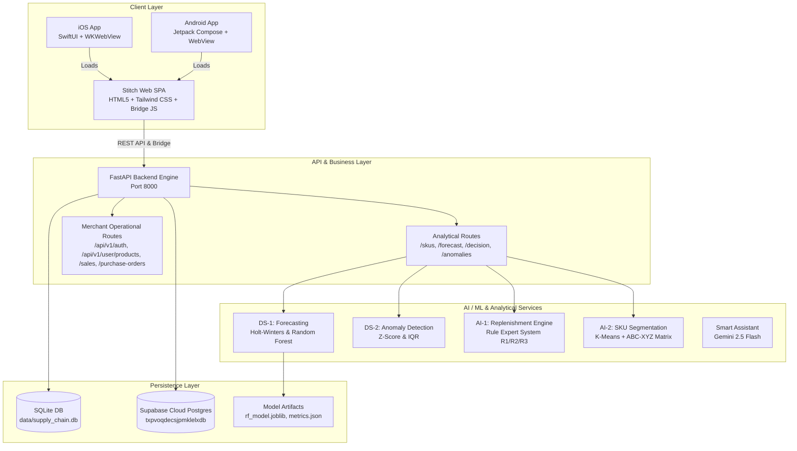

# SmartStock — Product Requirements Document (PRD)

## 1. Executive Summary & Vision
**SmartStock** is an intelligent, dual-audience retail supply chain demand forecasting, inventory optimization, and point-of-sale decision-support engine.

The platform bridges two distinct operational paradigms:
1. **The Shopkeeper Business View:** A clean, accessible, zero-friction mobile/desktop interface enabling non-technical local retail merchants (e.g. Kirana stores, grocery merchants) to track inventory, record sales with atomic stock deduction, receive plain-English replenishment recommendations, and generate purchase orders.
2. **The Academic Technical View:** A rigorous, mathematically validated Data Science and AI engine implementing four core academic methodologies (Short-Term Demand Forecasting, Anomaly Detection, Dynamic Reorder Expert System, and Automated SKU Segmentation) evaluated against industry-standard benchmarks.

---

## 2. System Architecture & Components

---

## 3. Verified Functional Capabilities

### 3.1 Point of Sale & Inventory Ledger
- **Atomic Stock Management:** Prevents overselling by checking `stock_on_hand >= units` in serialized transactions.
- **Paise-Accurate Accounting:** Calculations performed with `Decimal(0.01)` and integer paise to eliminate IEEE 754 floating point inaccuracies.
- **Cost Preservation:** Gross profit calculations retain original purchasing unit cost even if product price changes over time.
- **Inwarding Purchase Orders:** Atomic receipt of PO items automatically increments warehouse stock and updates status to `completed`.
- **Search & Categorization:** Fast client-side filtering, category dropdowns, and stock status pills (Active, Low Stock, Out of Stock).

### 3.2 Academic Machine Learning Engine
- **DS-1: Multi-Model Demand Forecasting:**
  - Baseline 1: Naive (last observed value).
  - Baseline 2: Seasonal Naive (7-day periodic lag).
  - Model 1: Holt-Winters Exponential Smoothing (damped additive trend, multiplicative 7-day seasonality).
  - Model 2: Recursive Random Forest Regressor (lag features: 1, 7, 14, 28 + rolling 7, 28 window statistics).
  - Evaluated on 90-day test horizon; achieves **28.18% RMSE improvement** over Naive baseline.
- **DS-2: Anomaly & Spike Detection:**
  - Group-specific statistical baselines evaluated by `(store, item, weekday)`.
  - Dual filters: Z-score ($|Z| > 3.0$) and IQR ($Q_1 - 1.5 \cdot IQR$ to $Q_3 + 1.5 \cdot IQR$).
  - Evaluated against 9,129 synthetic test spikes: **99.8% recall**, 57.87% precision, 0.0073 FPR.
  - Cleans historical anomalies with weekday median substitution to avoid distorting downstream forecasting.
- **AI-1: Dynamic Reorder Engine:**
  - Continuous-review $(s, S)$ inventory control expert system.
  - Calculates lead-time demand, classical safety stock ($Z \cdot \sigma_d \cdot \sqrt{L}$), and extended safety stock accounting for lead-time variability.
  - Evaluates priority-ordered decision rules:
    - `R1_EXPEDITE`: $IP \le ROP \land OnOrder > 0 \land Cover < L$
    - `R2_REORDER`: $IP \le ROP$
    - `R3_HOLD`: $IP > ROP$
  - Proved in 90-day simulation across 500 SKUs to **reduce stockout days by 54.03%** compared to static safety stock.
- **AI-2: Automated SKU Segmentation:**
  - ABC Volume Classification: 80% / 15% / 5% cumulative volume share.
  - XYZ Variability Classification: Demand Coefficient of Variation ($CV = \sigma / \mu$).
  - 9-box matrix mapped to Strategic, Core, and Tail management tiers.
  - K-Means clustering ($K=2$) optimizing silhouette score to **0.5847**.

---

## 4. Technical Specifications & Dependencies
- **Backend:** Python 3.9+ / 3.11+, FastAPI 0.110+, Uvicorn 0.28+, Pydantic 2.6+, Scikit-Learn 1.4+, Statsmodels 0.14+, Pandas 2.1+, NumPy 1.26+.
- **Frontend:** Vanilla ES6+ JavaScript, Tailwind CSS, Material Symbols Outlined, Canvas 2D, HTML5 Web Storage.
- **Testing Frameworks:** Pytest 8.0+ (`pytest-cov`), Node.js native test runner (`node:test`), Playwright 1.56+.
- **Database Support:** SQLite 3 (WAL mode) and Supabase PostgreSQL with RLS.
- **Mobile Platforms:** iOS (Xcode 15+, SwiftUI, iOS 16+) and Android (API 26+, Jetpack Compose, Kotlin 1.9+).
