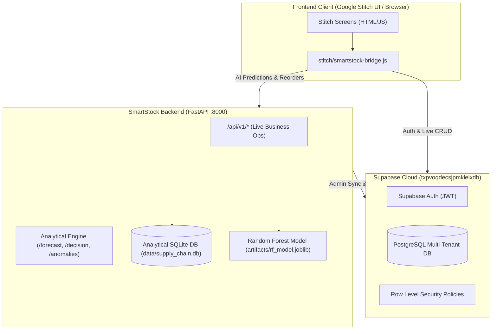

# SmartStock — Frontend Integration Guide

This guide details how the Google Stitch UI interface connects to the SmartStock Python backend and Supabase PostgreSQL database.

---

## 1. Architecture & Service Distribution



---

## 2. Environment & Configuration

| Service | Environment Variable | Default / Production Target |
|---|---|---|
| **Backend API Base URL** | `API_BASE_URL` | `http://localhost:8000` (or deployed Space URL) |
| **Supabase URL** | `SUPABASE_URL` | `https://txpvoqdecsjpmklelxdb.supabase.co` |
| **Supabase Public Anon Key** | `SUPABASE_ANON_KEY` | *(Configured in `.env` and `smartstock-bridge.js`)* |
| **Analytical API Key** | `API_KEY` | Optional. If set, require header `X-API-Key`. |

---

## 3. Storage Distinction: Analytical vs Live Records

1. **Analytical Engine Endpoints (`/forecast`, `/decision`, `/skus`, `/anomalies`, `/metrics`):**
   - Query the reproducible historical dataset (`data/supply_chain.db`).
   - SKUs are formatted as `S{store:02d}-I{item:02d}` (e.g., `S01-I01`).
   - Use fixed seed (42) and trained models for academic reproducibility.
2. **Live Application Endpoints (`/api/v1/products`, `/api/v1/insights`, `/api/v1/purchase-orders`, `/api/v1/shop`):**
   - Query the persistent Supabase PostgreSQL database.
   - SKUs are store-assigned (e.g. `SKU-89240`).
   - Stores possess `analytical_sku_id` adapters (e.g. `SKU-89240` $\rightarrow$ `S01-I01`) allowing users to request forecasts and decisions for live inventory items!

---

## 4. Frontend Client Bridge Integration

Include `@supabase/supabase-js` and `smartstock-bridge.js` in your HTML screens:

```html
<script src="https://cdn.jsdelivr.net/npm/@supabase/supabase-js@2"></script>
<script src="../smartstock-bridge.js"></script>
```

### Sign In Flow
```javascript
// Authenticate merchant against Supabase Auth
const { data, error } = await SmartStock.signIn('sarah@theneststore.com', 'NestStock2024!');
if (!error) {
  // Session stored automatically in localStorage('smartstock_session')
  window.location.href = '02_overview.html';
}
```

### Fetch Live Products
```javascript
const products = await SmartStock.getProducts();
console.log('Active Products:', products);
```

### Request Real-Time AI Demand Forecast
```javascript
// Fetches 14-day recursive Random Forest forecast
const forecast = await SmartStock.getForecast(1, 1, 14, 'daily', 'best');
console.log('Forecast Data Points:', forecast.forecasts);
```

### Request AI Replenishment Recommendation
```javascript
// Evaluates lead time, safety stock, and priority rules
const decision = await SmartStock.getDecision(1, 1, 24, 0);
console.log(`Action: ${decision.action}, Priority: ${decision.priority}, Qty: ${decision.recommended_order_qty}`);
console.log(`Explanation: ${decision.explanation}`);
```

---

## 5. Standard Error Handling

All backend and Supabase API responses follow consistent JSON error formats:

```json
{
  "detail": "Descriptive human-readable error message"
}
```

HTTP Status Codes:
- `200 OK`: Request succeeded.
- `401 Unauthorized`: Missing or invalid bearer token or API key.
- `404 Not Found`: Unknown SKU or resource ID.
- `422 Unprocessable Entity`: Validation error (e.g., horizon_days not multiple of 7 for weekly forecasts, batch size > 100).
- `500 Internal Server Error`: Server exception.
