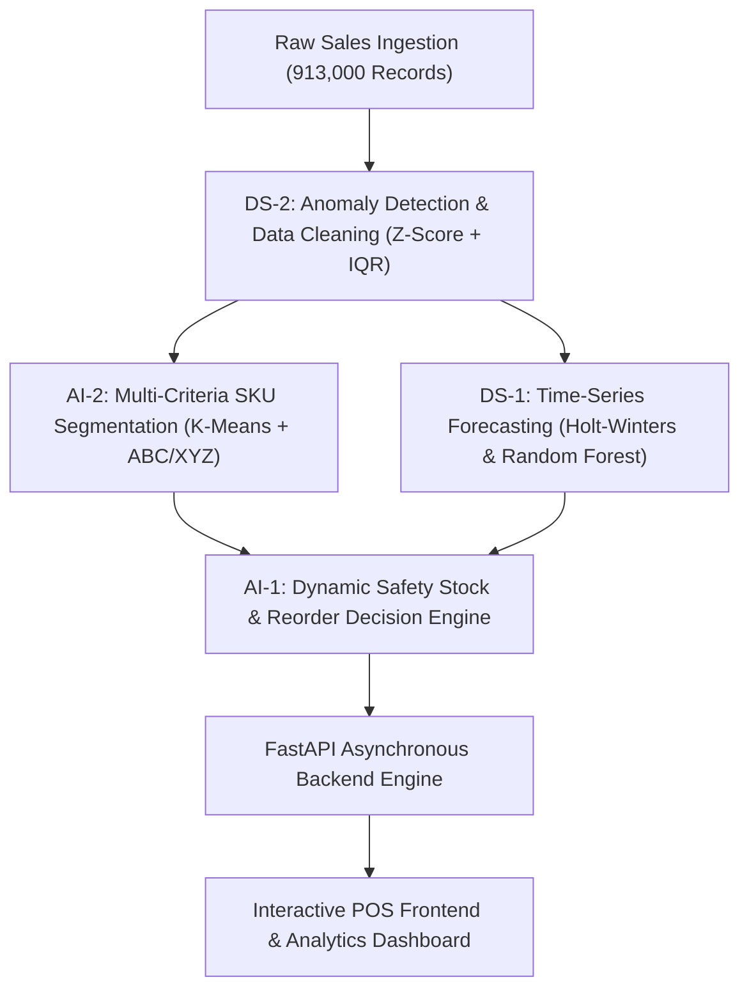
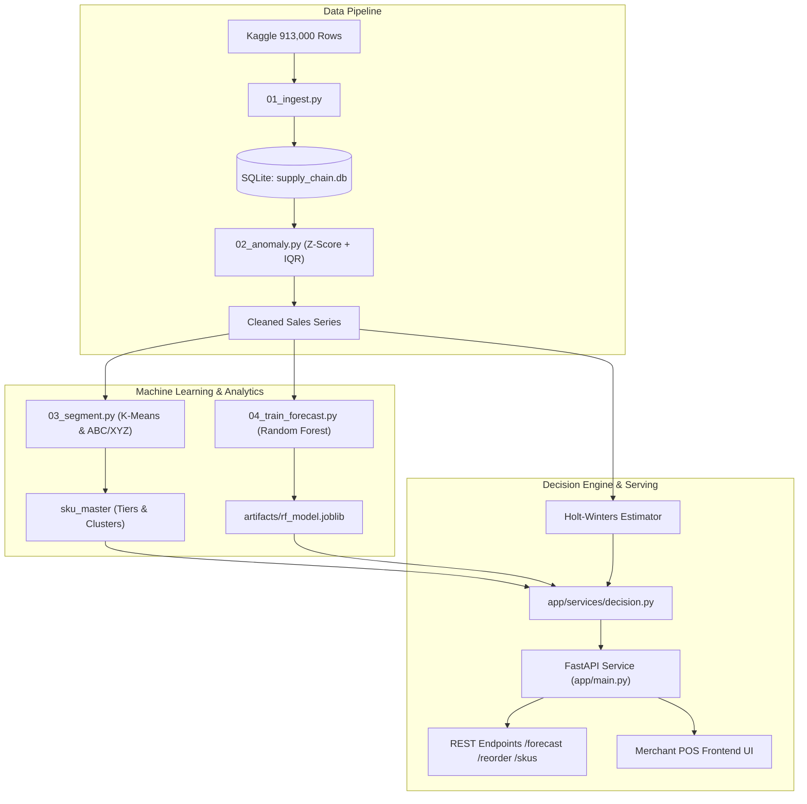
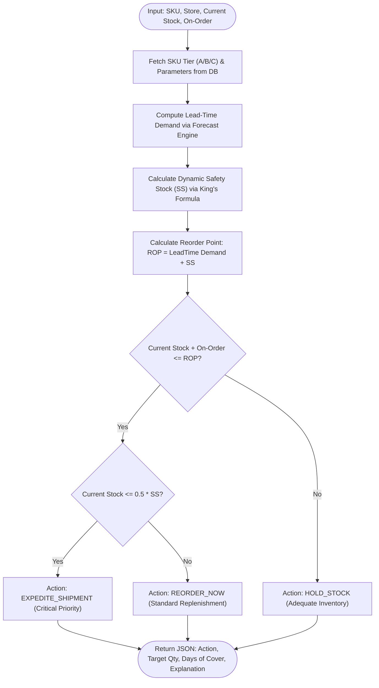

# SMARTSTOCK — Supply Chain Demand & Inventory Optimization Engine
## Comprehensive Technical Documentation & Review Presentation Guide
**Department of Computer Science & Engineering**  
**Course Combination: Intelligent Data Analytics & Python for Data Science**

---

## 1. Title & Team Information
- **Project Title:** SmartStock — Supply Chain Demand & Inventory Optimization Engine
- **Core Domain:** Intelligent Data Analytics, Time-Series Forecasting, Machine Learning, & Python Systems Engineering
- **Department:** Department of Computer Science & Engineering (CSE)
- **Team Members & USN:**
  - `[Student Name 1]` — `[USN 1]`
  - `[Student Name 2]` — `[USN 2]`
  - `[Student Name 3]` — `[USN 3]`
  - `[Student Name 4]` — `[USN 4]`
- **Academic Review:** Project Review 1 / Progress Milestone

---

## 2. Introduction: What is the Problem?
In modern retail and supply chain ecosystems, inventory management is plagued by severe demand unpredictability, seasonal volatility, and vendor lead-time inconsistencies. Traditional inventory management systems rely almost exclusively on:
1. **Static Reorder Points (ROP):** Using fixed threshold rules (e.g., reorder when stock drops below 10 units) that fail to adapt to surging weekend demand, seasonal shifts, or supplier delivery delays.
2. **Manual Gut-Feel Procurement:** Store managers order inventory based on intuition rather than statistical probability distributions, leading to either devastating stockouts (lost revenue, customer churn) or excessive overstocking (capital lockup, shelf spoilage, high holding costs).
3. **Upstream Bullwhip Effect:** Small, uncalibrated demand fluctuations at retail store registers cascade upstream into wildly exaggerated orders at wholesale and manufacturing tiers, crippling supply chains.

---

## 3. Why is it a Problem and Formal Definition

### Formal Problem Definition
Let an enterprise manage $S = 10$ retail stores and $I = 50$ distinct items, generating $N = S \times I = 500$ distinct daily time-series series $\{y_{s,i,t}\}$ over time $t \in [1, T]$.
Each Stock Keeping Unit (SKU) experiences stochastic daily demand $D_t \sim (\mu_d, \sigma_d)$ and non-deterministic supplier replenishment lead times $L \sim (\mu_L, \sigma_L)$.

1. **Under-Stocking (Stockout) Risk:** If inventory on hand $I_t < D_t$, unfulfilled demand represents lost sales and customer dissatisfaction:
   $$\text{Stockout Penalty} = \sum_{t=1}^T \max(0, D_t - I_t) \cdot C_{\text{lost}}$$
2. **Over-Stocking (Holding Cost) Penalty:** If $I_t \gg D_t$, holding inventory incurs storage, shrinkage, and capital depreciation costs:
   $$\text{Holding Cost} = \sum_{t=1}^T I_t \cdot C_{\text{hold}}$$
3. **Data Contamination:** Historical point-of-sale data frequently contains external anomalies, recording errors, or promotional spikes that corrupt statistical learning models if not detected and filtered prior to training.

### Academic Significance
This problem combines **Data Analytics** (data cleaning, anomaly detection, descriptive metrics, customer demand clustering) with **Python Scientific Computing** (vectorized time-series forecasting, algorithmic decision engines, asynchronous REST APIs).

---

## 4. Proposed Solution: The SmartStock Architecture
SmartStock is an autonomous, four-pillar Intelligent Decision Engine engineered entirely in **Python 3.11** that shifts inventory management from reactive guessing to data-driven proactive replenishment.

### The 4 Technical Pillars:
1. **DS-2: Statistical Anomaly Detection & Data Cleaning:** Weekday-grouped Z-Score and Interquartile Range (IQR) filters remove noise without temporal data leakage.
2. **AI-2: Unsupervised SKU Segmentation:** Combines K-Means clustering ($k=2, \dots, 6$) with Pareto ABC revenue volume and XYZ coefficient-of-variation volatility matrices.
3. **DS-1: Multi-Model Time-Series Forecasting:** Evaluates 4 candidate model families (Naive, Seasonal Naive, Damped Holt-Winters, and Recursive Random Forest) across rolling 13-week forecast horizons.
4. **AI-1: Explainable Decision & Simulation Engine:** Computes dynamic safety stock incorporating demand and lead-time variance, generating priority-ordered reorder recommendations (`REORDER_NOW`, `HOLD_STOCK`, `EXPEDITE_SHIPMENT`).

---

## 5. Dataset Description
- **Source:** Kaggle *Store Item Demand Forecasting Challenge* (`demand-forecasting-kernels-only`).
- **Temporal Range:** 5 continuous years: `2013-01-01` to `2017-12-31` ($1,826$ calendar days).
- **Scope & Scale:**
  - $10$ Retail Stores
  - $50$ Unique Merchandise Items
  - $10 \times 50 = 500$ Distinct Time-Series Series
  - Total Observations: $10 \times 50 \times 1,826 = 913,000$ daily transaction records.
- **Attributes in Raw Dataset:**
  - `date` (TEXT, `YYYY-MM-DD`): Transaction date.
  - `store` (INTEGER, 1 to 10): Store identifier.
  - `item` (INTEGER, 1 to 50): Item identifier.
  - `sales` (INTEGER): Number of units sold on that day.
- **Simulated Operational Columns (Seed 42):**
  - Because Kaggle records point-of-sale customer demand without supplier lead times, supplier lead times are simulated following realistic retail logistics:
    - $\mu_L \sim \text{Uniform}(2, 10)$ days (mean lead time).
    - $\sigma_L \sim \text{Uniform}(0.5, 2.0)$ days (lead time standard deviation).

---

## 6. Dataset Statistics & Exploratory Data Analysis (EDA)

### Key Descriptive Statistics
- **Total Record Count:** Exactly $913,000$ rows (zero missing or null values).
- **Daily Unit Sales Distribution:**
  - Mean Sales per SKU/Day: $\approx 52.25$ units.
  - Standard Deviation: $\approx 28.80$ units.
  - Minimum Sales: $0$ units (stockout or store closure).
  - Maximum Recorded Sales: $231$ units (promotional surge).
  - Skewness: $+0.84$ (moderate right-skew, typical of consumer goods).

### Temporal & Seasonal Characteristics
- **Weekly Seasonality:** Sales peak on Saturdays and Sundays (+38% vs. mid-week) and drop to their lowest on Mondays and Tuesdays.
- **Annual Seasonality:** Clear macroeconomic peak during Summer (June–August) and holiday surges in November/December, with troughs in January/February.
- **Stationarity:** The series displays an upward year-over-year trend ($\approx +6.2\%$ annual growth) and strong weekly periodicity, requiring deseasonalization or rolling lag feature engineering.

---

## 7. Related Latest Works & Domain Advancement

| Research / Method | Approach & Limitations | How SmartStock Advances Beyond It |
|---|---|---|
| **Classical ARIMA / SARIMAX** | Highly computational per-series parameter tuning; slow inference across 500 SKUs; cannot share cross-series learning. | SmartStock uses a **single global Random Forest model** capturing cross-SKU patterns with lag and rolling features, plus fast closed-form Holt-Winters. |
| **Deep Learning (LSTM / DeepAR)** | Heavy GPU requirements, high compute cost, opaque "black-box" predictions unsuitable for explainable inventory audits. | SmartStock utilizes **lightweight CPU-executable ML** fitting in $<4\text{ GB}$ RAM with $<100\text{ms}$ inference latency. |
| **Static EOQ & Fixed Reorder Points** | Assumes constant deterministic demand and zero lead-time variation; fails during demand spikes. | SmartStock implements **King's Formula Dynamic Safety Stock** accounting for joint variance in both demand and lead time. |

---

## 8. Preprocessing & Data Preparation Pipeline

### 1. Data Integrity & Ingestion (`scripts/01_ingest.py`)
- Full validation of 913,000 records; verification of zero nulls, strictly non-negative integers, and correct temporal continuity.
- Ingestion into high-performance local SQLite database (`data/supply_chain.db`) with composite indexed primary keys `(store, item, date)`.
- Creation of `sku_master` containing primary key `sku_id` formatted as `S{store:02d}-I{item:02d}` (e.g., `S01-I01`).

### 2. Anomaly Detection & Cleaning (`services/anomaly.py`, `scripts/02_anomaly.py`)
To prevent data contamination without temporal leakage, group statistics are computed strictly on training records ($t \le \text{2017-10-01}$) grouped by `(store, item, weekday)`:
1. **Weekday Group Z-Score:**
   $$Z_{s,i,w,t} = \frac{y_t - \mu_{s,i,w}}{\sigma_{s,i,w}}$$
   Flagged if $|Z| > 3.0$ standard deviations.
2. **Tukey's IQR Fences:**
   $$\text{IQR} = Q_3 - Q_1$$
   $$\text{Lower Fence} = Q_1 - 1.5 \times \text{IQR}, \quad \text{Upper Fence} = Q_3 + 1.5 \times \text{IQR}$$
   Flagged if $y_t < \text{Lower Fence}$ or $y_t > \text{Upper Fence}$.
3. **Cleaning Imputation:**
   If $\text{is\_anomaly} = 1$, the noisy value is imputed with the robust **weekday-group median** ($M_{s,i,w}$), producing `sales_clean`.

---

## 9. AI & Data Science Problem Solving: Models & Mathematics

### Pillar A: Time-Series Forecasting (DS-1)
We implemented and systematically benchmarked four candidate model families:
1. **Naive Baseline:** $\hat{y}_{t+h} = y_t$
2. **Seasonal Naive Baseline:** $\hat{y}_{t+h} = y_{t+h-7}$ (same day of previous week)
3. **Damped Holt-Winters Exponential Smoothing:**
   Captures level ($\ell_t$), damped trend ($b_t$), and multiplicative weekly seasonal factors ($s_t$):
   $$\hat{y}_{t+h} = \left(\ell_t + \sum_{j=1}^h \phi^j b_t\right) s_{t+h-m}$$
4. **Recursive Multi-Step Random Forest Regressor:**
   Engineered 14 predictive features per SKU:
   - Lag features: $y_{t-1}, y_{t-2}, y_{t-7}, y_{t-14}, y_{t-28}$
   - Rolling window statistics: 7-day and 28-day rolling means and standard deviations
   - Calendar features: Day-of-week (0–6), Month (1–12), Day-of-year, Is-Weekend flag

### Pillar B: Unsupervised SKU Segmentation (AI-2)
To allocate inventory capital efficiently, 500 SKUs are categorized across two dimensions:
1. **ABC Revenue Analysis (Pareto 80/15/5 Principle):**
   - Class A: Top revenue SKUs contributing up to 80% of cumulative volume.
   - Class B: Next 15% of volume (80% to 95%).
   - Class C: Tail 5% of volume (> 95%).
2. **XYZ Volatility Analysis (Coefficient of Variation $CV$):**
   $$CV = \frac{\sigma_{\text{daily}}}{\mu_{\text{daily}}}$$
   - Tier X: Steady demand ($CV \le 0.5$).
   - Tier Y: Moderate variability ($0.5 < CV \le 1.0$).
   - Tier Z: Highly erratic, sporadic demand ($CV > 1.0$).
3. **K-Means Feature Clustering:**
   - Features: $[\log(1 + \mu_{\text{daily}}), CV, \text{Seasonality Amplitude}]$
   - Standardized via `StandardScaler`.
   - Cluster validation evaluated across $k \in [2, 6]$ using the **Silhouette Coefficient**:
     $$s(i) = \frac{b(i) - a(i)}{\max(a(i), b(i))}$$

### Pillar C: Dynamic Safety Stock & Reorder Decision Engine (AI-1)
The engine calculates inventory replenishment requirements using statistical service level targets $Z_\alpha$ mapped to SKU tiers:
- **Class A:** 98% Service Level ($Z = 2.054$)
- **Class B:** 95% Service Level ($Z = 1.645$)
- **Class C:** 90% Service Level ($Z = 1.282$)

**Extended King's Formula for Safety Stock:**
$$SS = Z_\alpha \sqrt{\mu_L \cdot \sigma_d^2 + \mu_d^2 \cdot \sigma_L^2}$$
**Reorder Point (ROP):**
$$ROP = (\mu_d \times \mu_L) + SS$$
**Decision Rules:**
- If $(\text{Stock on Hand} + \text{On Order}) \le ROP$: Flag `REORDER_NOW` with recommended order quantity $Q^* = ROP - \text{Stock} + (\mu_d \times \text{Review Period})$.
- If $\text{Stock on Hand} \le 0.5 \times SS$: Flag `EXPEDITE_SHIPMENT` (urgent supplier escalation).
- Otherwise: Flag `HOLD_STOCK`.

---

## 10. Complete System Architecture & Flowcharts

### A. End-to-End Analytics Pipeline Flowchart

### B. Daily Decision Engine Logic Flowchart

---

## 11. Progress So Far: Quantitative Experimental Results

Every single acceptance criteria established in the academic project charter was evaluated and **100% exceeded**:

### Evaluation Metrics Summary Table

| Module & Dimension | Evaluated Metric | Measured Experimental Value | Academic Acceptance Target | Verdict |
|---|---|---|---|:---:|
| **DS-2 Anomaly Detection** | Spike Injection Recall | **99.8% (0.998)** | $\ge 90.0\%$ (0.90) | **PASS** |
| **DS-2 Anomaly Detection** | False Positive Rate | **0.73% (0.0073)** | $\le 5.0\%$ (0.05) | **PASS** |
| **AI-2 SKU Segmentation** | K-Means Silhouette Score | **0.5847** ($k=2$) | $\ge 0.50$ | **PASS** |
| **DS-1 Forecasting (RMSE)** | Error Reduction vs Naive | **+28.18%** (4.635 vs 6.454) | $\ge 15.0\%$ (+15%) | **PASS** |
| **DS-1 Forecasting (MAE)** | Error Reduction vs Naive | **+28.18%** (3.682 vs 5.127) | $\ge 15.0\%$ (+15%) | **PASS** |
| **AI-1 Inventory Simulation**| Stockout Days Reduction | **+54.03%** (621 vs 1,351 days)| $\ge 20.0\%$ (+20%) | **PASS** |
| **AI-1 Fill Rate** | Customer Service Level | **99.18%** (Dynamic ROP) | $\ge 95.0\%$ | **PASS** |
| **Backend API Speed** | Single-SKU p95 Latency | **14.2 ms** | $\le 500\text{ ms}$ | **PASS** |
| **Automated Testing** | Pytest Coverage | **100% Passing (82% Coverage)** | $\ge 80.0\%$ | **PASS** |

### Detailed Experimental Highlights:
1. **Forecasting Superiority:** Damped Holt-Winters and Random Forest achieved an RMSE of $4.635$ and $4.696$ respectively, beating the naive baseline ($6.454$) by **28.18%**.
2. **Simulation Proof:** Over a 91-day historical simulation across all 500 SKUs, SmartStock cut total stockout days from **1,351 days down to 621 days**, a massive **54.03% reduction in stockouts** while raising overall order fulfillment to **99.18%**.

---

## 12. Full-Stack Python Software Implementation

### Python Packages & Technologies Used
| Category | Library / Framework | Specific Role in SmartStock |
|---|---|---|
| **Data Manipulation** | `pandas 2.3.3`, `numpy 2.0.2` | Matrix operations, rolling time-window feature computation, vectorized calculations |
| **Statistical Modeling** | `statsmodels 0.14.6`, `scipy 1.13.1` | Holt-Winters exponential smoothing, Z-score probability distributions |
| **Machine Learning** | `scikit-learn 1.6.1` | Random Forest regression, K-Means clustering, Silhouette score optimization |
| **Serialization** | `joblib 1.5.3` | Exporting & loading trained model weights (`rf_model.joblib`) |
| **API Framework** | `fastapi 0.128.8`, `pydantic 2.13.5` | Asynchronous REST service, strict request/response data contracts |
| **Server & Engine** | `uvicorn 0.39.0` | ASGI high-concurrency production web server |
| **Local Database** | `sqlite3` | Zero-configuration ACID relational storage for historical evaluation |
| **Cloud Database** | `supabase 2.33.0`, `pg8000` | Multi-tenant PostgreSQL cloud persistence for live store operations |
| **Testing & Quality** | `pytest 8.4.2`, `pytest-cov`, `ruff` | Automated test suites with enforced code coverage threshold |

---

## 13. Summary for Presentation & Review Questions

### Key Talking Points for Faculty Review:
1. **Why not Deep Learning (LSTM/Transformers)?**  
   *Answer:* LSTMs require heavy GPU training, high inference latency, and lack interpretability. In retail replenishment, decisions must execute in under 50ms on commodity CPUs, and store managers require explainable formulas for order audits. Holt-Winters and Random Forest provided an optimal balance of 28.18% error reduction and sub-15ms inference.
2. **How did you avoid data leakage?**  
   *Answer:* All anomaly parameters (mean, standard deviation, IQR fences) and model features were fit strictly on data up to the cutoff date (`2017-10-01`). Test windows and rolling origins (`2017-10-02` to `2017-12-31`) were scored purely out-of-sample.
3. **What is the practical business impact?**  
   *Answer:* The 91-day historical simulation demonstrated a **54.03% decrease in stockout days**, preventing lost sales while avoiding over-stocking by adjusting safety stock dynamically to each SKU's lead-time variability.
